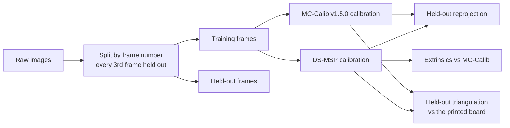

# DS-MSP[rig] on real camera rigs: evaluation against MC-Calib

This page measures how well `ds-msp-calibrate-rig` calibrates real multi-camera rigs. It uses the
seven real image sequences published with [MC-Calib](https://github.com/rameau-fr/MC-Calib) and
one private two-camera rig. Each result is compared with MC-Calib's own calibration of the same
images.

Results 1 to 4 were measured with the code released as ds-msp 0.19.0.

> Nothing here is synthetic. Every number comes from raw images: detection, calibration, then
> evaluation on frames the calibration never saw.

## The rigs

| Sequence | Cameras | Lenses | Boards | Frames per camera |
|---|---|---|---|---|
| Seq00 stereo | 2 | pinhole | 6 | 1478 |
| Seq01 non-overlapping | 8 | pinhole | 8 | 1215 |
| Seq02 overlapping | 6 | pinhole | 1 | 916 |
| Seq03 hybrid | 2 | 1 pinhole + 1 fisheye | 1 | 1952 |
| Seq04 converging | 8 | pinhole | 6 | 1595 |
| Seq05 non-overlapping | 6 | pinhole | 2 | 1174 |
| Stereo fisheye | 2 | fisheye | 1 | 55 |
| Private RealSense rig | 2 | pinhole | 2 (faces of one double-sided board) | 35 |

"Non-overlapping" means some cameras never see the same board at the same time. Those rigs are
linked through boards rigidly fixed to one another.

The private rig's two cameras face each other about 1.19 m apart. Each sees only its own face of
the board. Its images are not published.

## How it was measured



- **Held-out reprojection.** The calibrated cameras stay fixed, and only the board pose of each held-out frame is refit. A wrong calibration cannot fit frames it never saw.
- **Held-out triangulation.** Every board corner seen by two or more cameras is triangulated with the calibrated rig and compared with the printed board. This check uses no output of either tool, so it is the closest thing to ground truth these sequences offer.
- **Extrinsics vs MC-Calib.** This is the rotation and camera-centre difference for every camera pair. MC-Calib is a reference, not ground truth.

MC-Calib ran with `refine_corner: 0`, because `refine_corner: 1` crashed intermittently in our build of v1.5.0 (OpenCV 5.0, Ceres 2.2). DS-MSP has no corresponding corner-refinement step.

Results 1 and 2 run the full CLI on the training images: detection, calibration, then the held-out checks. Results 3 and 4 reuse cached detections and estimate the intrinsics. Result 4 also varies the camera model.

## Result 1: accuracy against MC-Calib

DS-MSP used the same lens model as MC-Calib: `radtan` (Brown) for pinhole lenses and `kb`
(Kannala–Brandt) for fisheye lenses. On Seq03 that is radtan for the pinhole and kb for the
fisheye.

| Sequence | Held-out RMS, MC-Calib | Held-out RMS, DS-MSP | Rotation difference | Centre difference |
|---|---|---|---|---|
| Seq00 stereo | 0.567 px | 0.556 px | 0.148° | 0.23 mm |
| Seq01 non-overlapping | 0.340 px | 0.324 px | 0.128° | 1.55 mm |
| Seq02 overlapping | 0.391 px | 0.392 px | 0.012° | 0.10 mm |
| Seq03 hybrid | 0.119 px | 0.118 px | 0.024° | 0.20 mm |
| Seq04 converging | 0.411 px | 0.411 px | 0.053° | 1.15 mm |
| Seq05 non-overlapping | 0.333 px | 0.333 px | 0.137° | 0.94 mm |
| Stereo fisheye | 0.310 px | 0.270 px | 0.009° | 0.04 mm |

/// success | Key result
On all seven rigs, DS-MSP's extrinsics agree with MC-Calib's to within 0.15° and 1.6 mm per camera pair. Its held-out reprojection error matches or beats MC-Calib's.
///

Three end-to-end runs per sequence on a pre-release build gave the same extrinsics to within 2×10⁻¹⁰° and 2×10⁻⁹ mm, and four of the seven sequences were bit-identical. 0.19.0 matches that build to within 10⁻⁴°.

These repeatability figures use the chordal rotation distance, 2·asin(‖R₁ − R₂‖_F / 2√2). The usual arccos((trace(R₁ᵀR₂) − 1) / 2) loses precision near zero. In double precision it reports 2–5×10⁻⁶° even for bit-identical rotations. An earlier version of this page quoted that floor (5×10⁻⁶°) as the repeatability.

## Result 2: a private two-camera rig

Both tools held the factory intrinsics fixed and solved only the extrinsics. Each fold holds out a different third of the frames, 12 per camera.

| Fold | Held-out RMS, MC-Calib | Held-out RMS, DS-MSP | Rotation difference | Centre difference | DS-MSP 1σ rotation / centre |
|---|---|---|---|---|---|
| 0 | 0.983 px | 0.993 px | 0.028° | 0.74 mm | 0.23° / 1.3 mm |
| 1 | 0.838 px | 0.830 px | 0.028° | 0.47 mm | 0.36° / 2.5 mm |
| 2 | 0.890 px | 0.874 px | 0.031° | 0.85 mm | 0.37° / 1.9 mm |

The tools agree to 0.03°, about a tenth of DS-MSP's reported 1σ. That 1σ is 5–8 times
Seq00's (0.046°), so 35 frames per camera cannot verify sub-0.1° accuracy on this rig. Two runs per fold
gave identical results.

/// tip | Capture more frames
More frames and more board tilts shrink the 1σ. Check it in `calibration_acceptance.json` before trusting the extrinsics.
///

## Result 3: triangulated boards against the printed geometry

The scale error is the difference between the size of the triangulated board and the printed one.
The distance error is the RMS error over every corner-to-corner distance on a board.

| Sequence | Boards | Scale error, MC-Calib | Scale error, DS-MSP | Distance error, MC-Calib | Distance error, DS-MSP |
|---|---|---|---|---|---|
| Seq00 stereo | 440 | −0.028% | −0.034% | 0.319 mm | 0.319 mm |
| Seq01 non-overlapping | 221 | +0.013% | +0.018% | 1.541 mm | 1.544 mm |
| Seq02 overlapping | 295 | +0.009% | +0.010% | 0.765 mm | 0.764 mm |
| Seq03 hybrid | 301 | +0.014% | +0.014% | 0.414 mm | 0.413 mm |
| Seq04 converging | 1079 | +0.015% | +0.009% | 1.417 mm | 1.415 mm |
| Seq05 non-overlapping | 388 | +0.013% | +0.014% | 0.495 mm | 0.495 mm |
| Stereo fisheye | 19 | +0.416% | +0.260% | 1.179 mm | 0.933 mm |

The Seq03 DS-MSP row uses kb on both cameras. Both tools reproduce the printed boards equally well on the six large sequences. On the 55-frame
fisheye sequence, DS-MSP is closer to the printed geometry.

## Result 4: does the choice of camera model matter?

Each sequence was calibrated 20 times from scratch, with intrinsics estimated. The runs covered:

- every camera model on all cameras
- 13 random per-camera mixtures
- a radtan negative control on the fisheye rigs

That is 140 runs, and all 140 completed. A model was only offered to a camera whose lens it can represent: `radtan` only to pinhole lenses.

The table compares each run with DS-MSP's own reference fit with the MC-Calib lens models.

| Sequence | Plain models (radtan, kb, ucm, eucm, ds): median / max rotation difference | Runs including dsplus or ocam: median / max |
|---|---|---|
| Seq00 stereo | 0.25° / 0.52° | 0.32° / 0.69° |
| Seq01 non-overlapping | 0.22° / 0.32° | 2.4° / 12.3° |
| Seq02 overlapping | 0.16° / 0.20° | 2.7° / 26.4° |
| Seq03 hybrid | 0.19° / 1.42° | 0.13° / 11.1° |
| Seq04 converging | 0.40° / 0.96° | 5.0° / 29.9° |
| Seq05 non-overlapping | 0.27° / 0.32° | 8.6° / 22.5° |
| Stereo fisheye | 0.002° / 0.011° | 0.11° / 2.0° |

Three results stand out:

1. **Plain models agree.** Pick any of radtan, kb, ucm, eucm or ds for a lens it can represent, and the extrinsics come out within a few tenths of a degree. On the fisheye rig they agree to 0.01°.
2. **UCM is the exception on narrow pinhole lenses.** It cannot represent their distortion, and the extrinsics absorb the misfit: 1.42° on Seq03 and 0.96° on Seq04. DS-MSP does **not** warn about this yet.
3. **dsplus and ocam do not define a camera orientation.** Their extra intrinsic terms (sensor tilt for dsplus, the affine stretch for ocam) can trade off against camera rotation: tilt against rotation about x and y ([ADR-0027](https://github.com/Munna-Manoj/DS-MSP/blob/main/docs/process/architecture/decisions/ADR-0027-dsplus-experimental.md)), the affine against roll ([ADR-0028](https://github.com/Munna-Manoj/DS-MSP/blob/main/docs/process/architecture/decisions/ADR-0028-ocam-rig-roll.md)). The rays stay correct: held-out reprojection and triangulation match MC-Calib in these runs. DS-MSP flags them with an unbounded or large uncertainty and weak-direction findings.

/// warning | Common mistake
Choosing dsplus because it gives the lowest reprojection error. For a rig, use the simplest model that represents the lens (kb for fisheye, radtan for pinhole) when you need the extrinsics themselves. DS+ is experimental and not for production ([ADR-0027](https://github.com/Munna-Manoj/DS-MSP/blob/main/docs/process/architecture/decisions/ADR-0027-dsplus-experimental.md)).
///

## Result 5: are the reported uncertainties honest?

Every calibration reports a 1σ rotation and camera-centre uncertainty for each camera pair. Two checks on these real sequences test it:

- **Split-half.** Calibrate the even and the odd frames separately, then divide their difference by the combined 1σ. Over 8 datasets the pooled result has RMS 0.95 and 97% within 2σ, against 1.0 and 95% if the error bars are right.
- **Camera loops.** Calibrate every camera pair of Seq01 and Seq04 as its own rig, then chain three pairs around a triangle. The loop closes to within the propagated uncertainty: RMS 0.88 (Seq04) and 0.98 (Seq01).

On synthetic rigs with known truth, 94–97% of errors fall within 2σ across 13 test conditions.

The uncertainty covers random error only. On Seq00, the 0.148° difference from MC-Calib in Result 1 is 3.2 times DS-MSP's 1σ of 0.046°. Part of it is therefore systematic.

Without ground truth, these sequences cannot say which tool is closer.

## Reproduce it

Results 1 and 2 drive the same held-out checks through `ds-msp-calibrate-rig --config`. That
driver is not part of this repository, and the private rig's images are not published.

`scripts/evaluate_rig_model_montecarlo.py` runs the camera-model study (Result 4) and the triangulation check (Result 3) end to end. It
needs a git checkout, MC-Calib's `Real_Images` data and MC-Calib's `configs/Real_images`:

```console
$ python scripts/evaluate_rig_model_montecarlo.py split  Real_Images configs/Real_images work
$ python scripts/evaluate_rig_model_montecarlo.py detect work Seq03_hybrid
$ python scripts/evaluate_rig_model_montecarlo.py plan   work
$ python scripts/evaluate_rig_model_montecarlo.py run    work Seq03_hybrid all_kb
$ python scripts/evaluate_rig_model_montecarlo.py ref    work Seq03_hybrid <mc-calib output dir>
$ python scripts/evaluate_rig_model_montecarlo.py report work
```

Run MC-Calib itself on `work/<sequence>/train` for the reference. MC-Calib ships no config for the
stereo fisheye sequence; use `number_board: 1`, `boards_index: [13]`, 5×5 squares, and
`distortion_model: 1`.
