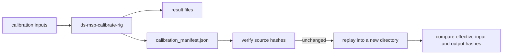

# Reproduce and audit a rig calibration

Use a DS-MSP run manifest to prove which code, data, configuration, and numerical environment
produced a rig calibration, then reproduce its deterministic artifacts in a separate directory.

This guide is for calibration operators, reviewers, and developers maintaining golden baselines.
It covers computational reproducibility. It does not certify physical calibration accuracy.

**Prerequisites**

- Complete the [multi-camera rig guide](../RIG_CALIBRATION_GUIDE.md) through one successful run.
- Use a DS-MSP source checkout. The calibration CLI ships on PyPI, but the Stage 0 replay utility
  currently lives in `tools/`.
- Keep the original images, keypoints, target description, config, and result directory available.
- Use Python 3.10 and `requirements-production.txt` for a release or golden-baseline replay.

The command blocks below continue from the same shell and repository root.

## Choose the smallest check that answers your question

Stage 0 provides two checks. Start with input verification because it finishes without calibration.

| Question | Command | Success means |
|---|---|---|
| Are the recorded source files still unchanged? | `--verify-only` | Every recorded file exists and has its original SHA-256 digest. |
| Can this environment reproduce the calibration? | `--output` | Inputs match, calibration completes, effective inputs match, and deterministic result hashes match. |



## 1. Prepare a reference environment

Use DS-MSP's exact production profile when byte-for-byte reproducibility matters.

<div class="termy">

```console
$ python3.10 -m venv .venv-production
$ source .venv-production/bin/activate
$ python -m pip install -r requirements-production.txt
$ python -m pip install -e .
```

</div>

Normal users can create and inspect manifests in any supported environment. A different Python,
NumPy, SciPy, OpenCV, or thread backend may legitimately produce different numerical artifacts.

/// warning | Do not mix OpenCV wheels
The reference profile uses `opencv-python`. Remove `opencv-python-headless` from the same environment.
The manifest records forbidden co-installations and reports whether the environment matches.
///

## 2. Create one attributed calibration run

Create a unique output directory for each accepted run. Do not reuse a previous result directory.

<div class="termy">

```console
$ WORKSPACE="$PWD/reproducibility-demo"
$ CONFIG="$WORKSPACE/calib_param.yml"
$ RUN_LABEL="$(date -u +%Y%m%dT%H%M%SZ)"
$ ORIGINAL="$WORKSPACE/$RUN_LABEL-original"
$ mkdir -p "$WORKSPACE"
$ ds-msp-calibrate-rig --init-config "$CONFIG"
wrote base calib_param template to: .../reproducibility-demo/calib_param.yml
```

</div>

Edit `root_path`, camera count, target geometry, camera models, and any initial-intrinsics path in
`$CONFIG`. The [rig config reference](../RIG_CALIBRATION_GUIDE.md#3-make-a-config) defines each field.

Run calibration with an explicit output override:

<div class="termy">

```console
$ ds-msp-calibrate-rig --config "$CONFIG" \
    --set "save_path=$ORIGINAL" \
    --no-webviewer
...
run manifest: .../reproducibility-demo/<UTC>-original/calibration_manifest.json
```

</div>

The manifest is automatic. You do not need a provenance flag.

Confirm the expected deliverables before accepting the run:

<div class="termy">

```console
$ MANIFEST="$ORIGINAL/calibration_manifest.json"
$ test -f "$MANIFEST" && test -f "$ORIGINAL/calibrated_cameras_data.yml" \
    && echo "Stage 0 artifacts present"
Stage 0 artifacts present
```

</div>

## 3. Read the run identity in the report

The text and JSON reports contain a compact reproducibility summary. The manifest contains the
complete evidence.

<div class="termy">

```console
$ grep -A 5 '^-- reproducibility --' "$ORIGINAL/calibration_report.txt"
-- reproducibility --
run id: 4a9b49bb344963ce80a7
source: 3fd400bec7e3db4b67efa691fdd306cf1407188e
reference environment: MATCH  (ds-msp-rig-production-py310-2026-09)
observation digest: b2a46df436b939b2635b8f3d98c68c33160dacf04d229755843ca36df6ad0dd1
```

</div>

Those values are from the Stage 0 acceptance run: **1,365 corners**, **64 observations**, and
**72 source files**. Your run ID, commit, digest, and counts will differ.

Interpret the fields as follows:

| Field | What it identifies | What to check |
|---|---|---|
| `run id` | This individual calibration execution | Use it in reports, issue titles, and baseline records. |
| `source` | Git commit used by the run | It should be an approved revision for production work. |
| `reference environment` | Match against the locked production profile | Require `MATCH` for golden or release evidence. |
| `observation digest` | Effective decoded 2D measurements | Equal digests mean the optimizer received the same observations. |

## 4. Inspect the complete manifest

Format the strict JSON with Python's standard library; no `jq` installation is required.

<div class="termy">

```console
$ python -m json.tool "$MANIFEST" \
    | grep -E '"(run_id|configuration_sha256|matches|n_corners|n_observations)"'
    "configuration_sha256": "...",
        "matches": true,
        "n_corners": 1365,
        "n_observations": 64,
"run_id": "4a9b49bb344963ce80a7",
```

</div>

Preserve the original `calibration_manifest.json` as the authoritative artifact.

The manifest records these evidence groups:

| JSON path | Evidence |
|---|---|
| `configuration` | Config path, resolved values, CLI overrides, and entry point |
| `configuration_sha256` | Stable identity of the effective configuration |
| `invocation` | Original arguments, replay arguments, working directory, and random seed |
| `software.git` | Commit, branch, tracked dirty state, and separate untracked-path digest |
| `environment` | Python/platform, numerical packages, backend fingerprints, and thread settings |
| `inputs.files` | Absolute path, size, existence state, and SHA-256 for every source file |
| `inputs.observations` | Count and digest of the effective decoded 2D observations |
| `inputs.target_geometry` | Count and digest of the target geometry presented to optimization |
| `outputs` | Path, type, size, and SHA-256 of each persisted result artifact |

/// tip | Why both file and effective-input hashes?
Source hashes prove the files did not change. Effective-input hashes additionally prove that
decoding and detection produced the same numerical observations and target geometry.
///

## 5. Verify the recorded inputs without recalibrating

Run the fast check before deployment, review, archival, or a full replay.

<div class="termy">

```console
$ python tools/replay_rig_manifest.py "$MANIFEST" --verify-only
inputs verified: 72 files
```

</div>

The count depends on the dataset. Exit status `0` means every recorded source file passed.

Capture the status in automation:

```bash
python tools/replay_rig_manifest.py "$MANIFEST" --verify-only
REPLAY_STATUS=$?
printf 'replay input verification status: %s\n' "$REPLAY_STATUS"
```

Treat any nonzero status as a failed evidence check. Do not replace the manifest's stored digest
to make changed data pass.

## 6. Reproduce into a separate directory

The replay tool preserves estimator-affecting arguments. It changes only destination and display
arguments, then compares the new run with the original manifest.

<div class="termy">

```console
$ REPLAY="$WORKSPACE/$RUN_LABEL-replay-01"
$ python tools/replay_rig_manifest.py "$MANIFEST" --output "$REPLAY"
inputs verified: 72 files
replaying: ... python -m ds_msp.rig.cli ...
...
reproduction verified: ...-replay-01/calibration_manifest.json
```

</div>

Success proves all of the following:

1. Every recorded source file still matches.
2. The replay decoded the same effective observations and target geometry.
3. Deterministic MC-Calib-compatible calibration artifacts have identical SHA-256 hashes.
4. The original result directory was not overwritten.

Reports and interactive HTML are excluded from byte comparison because they contain run-specific
identity and destination paths. Their own hashes remain recorded in each manifest.

## 7. Understand exit statuses and failures

Use the process exit status in shell scripts and CI. The message explains the failed layer.

| Status | Message family | Meaning | Next action |
|---:|---|---|---|
| `0` | `inputs verified` / `reproduction verified` | Requested evidence check passed | Retain the log with the manifest. |
| `1` | `REPLAY MISMATCH` | Calibration ran, but an effective-input or deterministic-output digest changed | Compare environments, code revisions, and optimizer inputs. |
| `2` | `REPLAY REFUSED`, `REPLAY INPUT ERROR`, or `REPLAY ERROR` | Preconditions failed or required evidence is absent | Correct the path/state; do not treat this as a numerical comparison. |
| other | Child calibration exit status | DS-MSP calibration itself failed | Diagnose the calibration error first. |

### Manifest not found

`RESULTS` and `/path/to/...` in documentation are explanatory names, not literal directories.
Locate the manifest produced under the original run's `save_path`:

<div class="termy">

```console
$ find "$PWD" -name calibration_manifest.json -type f -print
.../reproducibility-demo/<UTC>-original/calibration_manifest.json
```

</div>

### Recorded input is missing or changed

An input path must exist at its recorded absolute location and match its SHA-256 digest. Restore
the archived input tree or replay on the machine/storage mount that produced the run.

Do not silently substitute a renamed copy. The current Stage 0 contract intentionally refuses path
remapping because an unrecorded remap would weaken attribution.

### Output directory is not empty

Choose a new replay directory. Refusal protects prior evidence from accidental overwrite.

```text
REPLAY REFUSED: output path is not an empty directory: ...
```

### Reference environment reports `MISMATCH`

Recreate `.venv-production` from `requirements-production.txt`. Check Python, package versions,
OpenCV wheel conflicts, BLAS/backend details, and thread environment values in the manifest.

### Replay reaches `REPLAY MISMATCH`

Compare these sections between the original and replay manifests, in order:

1. `software.git`
2. `environment.reference`, `environment.packages`, and `environment.numerical_backend`
3. `configuration_sha256` and `invocation.replay_argv`
4. `inputs.observations.sha256` and `inputs.target_geometry.sha256`
5. `outputs`

The first differing layer usually identifies whether the cause is source, environment, decoded
inputs, or solver output.

## 8. Retain and share the evidence safely

Archive the complete original result directory, not only `calibrated_cameras_data.yml`.

Retain:

- all calibration result files, including the original manifest and reports;
- immutable input images or reused keypoints;
- the target-definition and initial-intrinsics files;
- the referenced Git commit or released source archive;
- `requirements-production.txt` for qualified baselines;
- the verification/replay log and its exit status.

The manifest records absolute file paths, working directories, and Git-root information. Review it
before sharing outside your organization because those fields may reveal usernames or storage layout.

Keep the original manifest unchanged. If policy requires a redacted copy, label it non-authoritative;
redaction breaks direct replay and must never replace the retained original.

## 9. Use Stage 0 in developer and release workflows

For a golden baseline, require a clean tracked worktree and the exact production environment.
Untracked datasets remain recorded separately and do not mark tracked source as dirty.

A minimal acceptance record should include:

| Item | Acceptance rule |
|---|---|
| Git state | Approved commit and `software.git.dirty: false` |
| Environment | `environment.reference.matches: true` |
| Input identity | Archived manifest plus successful `--verify-only` log |
| Calibration quality | Project-specific geometric and statistical gates pass |
| Reproduction | Full replay exits `0` in a new output directory |
| Traceability | Run ID is linked from the experiment, issue, PR, or release record |

The nightly release workflow also requires real-data tests to execute. An all-skipped dataset job is
not evidence, even when the test process exits successfully.

## 10. Know the boundary of the evidence

Stage 0 proves **computational identity**. It answers, “Can we identify and reproduce this result?”

It does not prove:

- that the camera intrinsics or extrinsics are physically correct;
- that a low reprojection residual generalizes to held-out frames;
- that translation is accurate to a required millimetre or centimetre tolerance;
- that the target dimensions, synchronization, or camera rigidity are correct;
- that the parameter covariance and observability are acceptable.

Use the manifest as the evidence foundation for later held-out projection tests, triangulation tests,
repeatability trials, uncertainty analysis, and physical ground-truth comparisons.

!!! success "Completion check"
    You have completed Stage 0 when the original result has a manifest, input verification exits
    `0`, a full replay exits `0` in the reference environment, and the run ID is retained with the
    result.

**Capture identity and acceptance controls.** Image filenames must end with their frame number:
`cam1_frame000007.png` and `cam2_frame000007.png` both identify frame 7. Otherwise set
`frame_pattern`, a regex whose `frame` group captures the number, e.g.
`frame_pattern: "img_(?P<frame>\\d+)_cam"` for `img_7_cam1.png`. Numberless names,
timestamp-like names (`1697551234.123456.png`), names ending in a camera id, duplicate frame
numbers within a camera, cameras that share no frame number, and mixed image sizes within a
camera are rejected. This indexing contract does not establish exposure synchronization;
prepare synchronized captures before calibration.

**Multi-board targets.** `structure_mode: "rigid"` (default) refines every board's pose inside
the target jointly with the cameras, keeping each board's printed shape. Use `"bend"` for a
target that may bow (foam or double-sided boards): it adds a three-parameter bow per board.
`"bend"` is experimental: on MC-Calib Seq00/Seq04 it lowers the median held-out error, but
pose fitting against the bowed target fails on about 2% of held-out frames.
`"free"` moves every target point and can absorb detector bias; with it, `structure_prior_sigma`
sets a Gaussian prior in the target's length units (for millimetres, `0.1` means 0.1 mm),
weighted at the measured corner noise. `"off"` keeps the averaged PnP inter-board poses.

**Pixel convention.** Corners are stored with integer coordinates at pixel centres. OpenCV 4.x
ChArUco corners are shifted by −0.5 px to match (5.0 already matches), so principal points are
0.5 px lower than in earlier releases. Keypoint caches written by earlier DS-MSP on OpenCV 4.x
need `keypoints_pixel_convention: "opencv4_charuco"`, or re-detect.

**Uncertainty and the production profile.** Every run records each camera pair's 1σ relative
rotation (degrees) and camera-centre (scene units) in `calibration_acceptance.json`. Set
`uncertainty_gate: "refuse"` with `max_rotation_sigma_deg` and `max_centre_sigma` to block export
of a capture that does not constrain the extrinsics; the gate uses the small-sample widened
`*_sigma_t` values (Student-t with frames − 1 degrees of freedom), which matter below ~20
frames. The σ covers random error only, not systematic detector bias. `profile: "production"` turns on the observability, uncertainty
and convergence refusals (limits required), hard rejection of board observations above `ransac_threshold`
(recorded one by one in the acceptance file), and refuses unknown config keys.

`audit_gate: "refuse"` runs the observability check before any calibration parameters are
exported. To require independent physical validation as well, supply `accuracy_profile_path`
and set `accuracy_gate: "refuse"`. Missing truth, unavailable required pairs, absent configured
limits, or failed limits refuse export. A reference comparison to MC-Calib does not substitute
for independent ground truth. With the accuracy gate off, diagnostic exports remain available;
`calibration_acceptance.json` records their acceptance status separately from fit quality.
Existing parameter files are not overwritten by a refused run.

**Solver status.** The acceptance file's `solver` entry lists every BA stage with its
termination status (`CONVERGED`, `NO_CONVERGENCE` or `NUMERICAL_FAILURE`), stop reason,
iterations and final RMS. It also lists cameras whose front-end fit fell back to a seed, and
camera groups hand-eye could not link. Only the last stage produced the exported estimate;
earlier stages are warm starts, and an unconverged warm start is not a problem by itself. A
`NUMERICAL_FAILURE` (a NaN or inf cost) in any stage stops the run. `convergence_gate: "warn"`
(default) warns when the final stage did not converge; `"refuse"` (the production default)
blocks export.

`Observation`, `BoardObs` and `ObjectObs` accept optional per-corner `pixel_covariances`.
Board fusion, object remapping, single-camera and rig bundle adjustment preserve these values.
DS-MSP keypoint caches preserve them in an optional `pixel_covariances` sequence parallel to
`pts_2d`; legacy caches without that field retain unit weights. Other MC-Calib consumers may
ignore this extension. See the [calibration API](../reference/calib.md) for units and validation.
